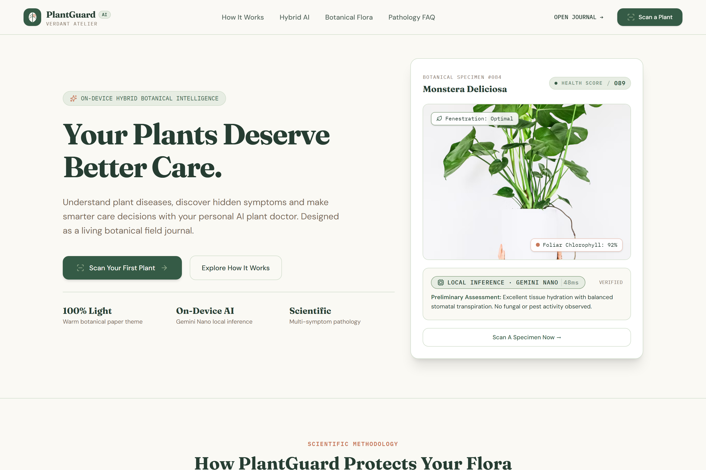
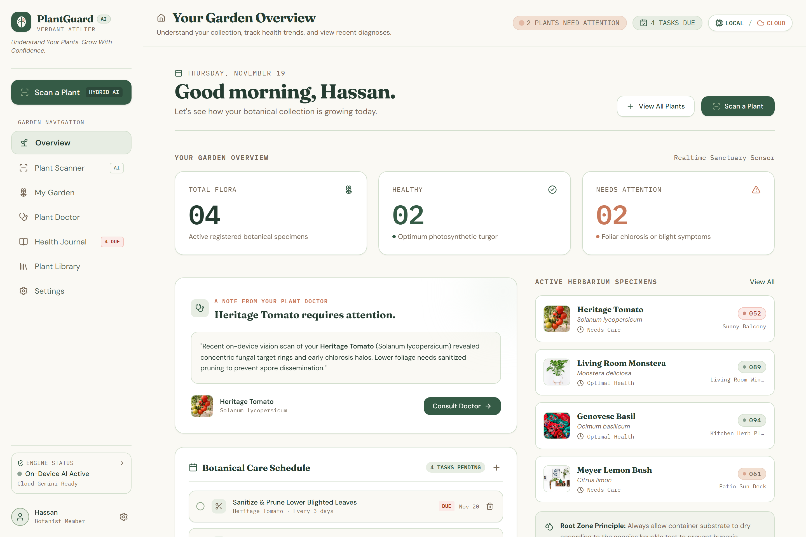
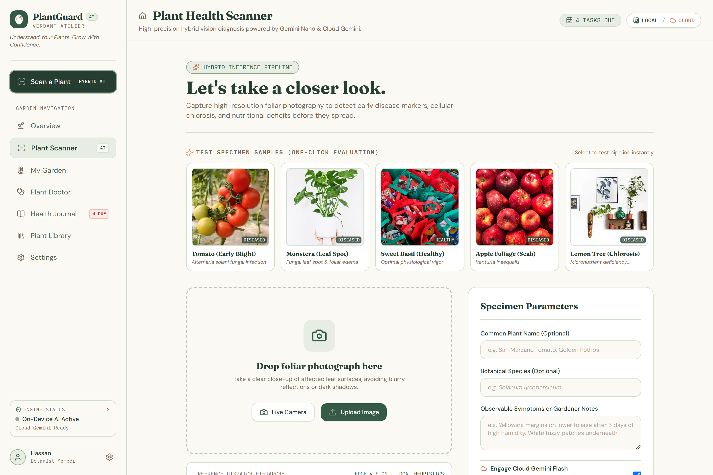
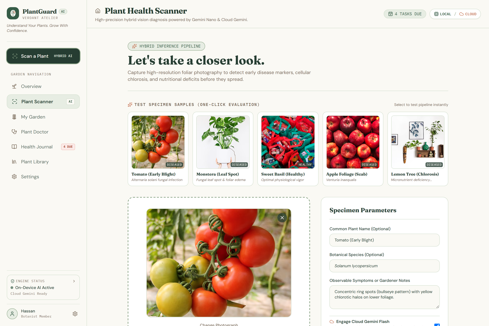
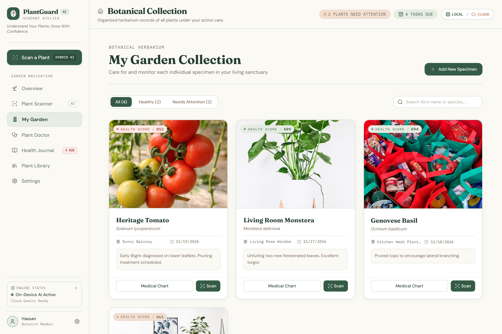
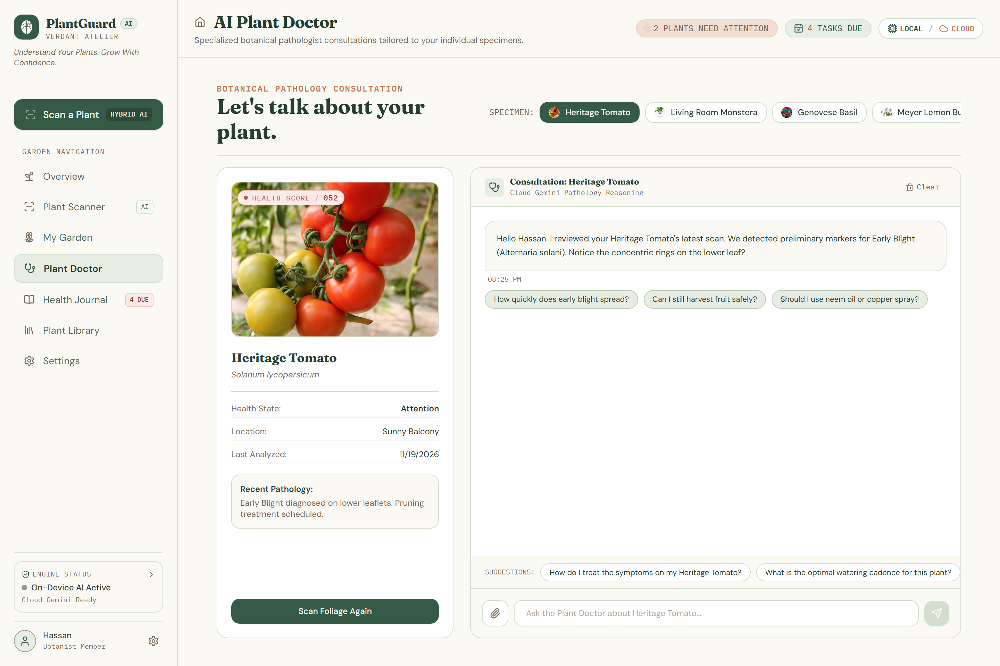
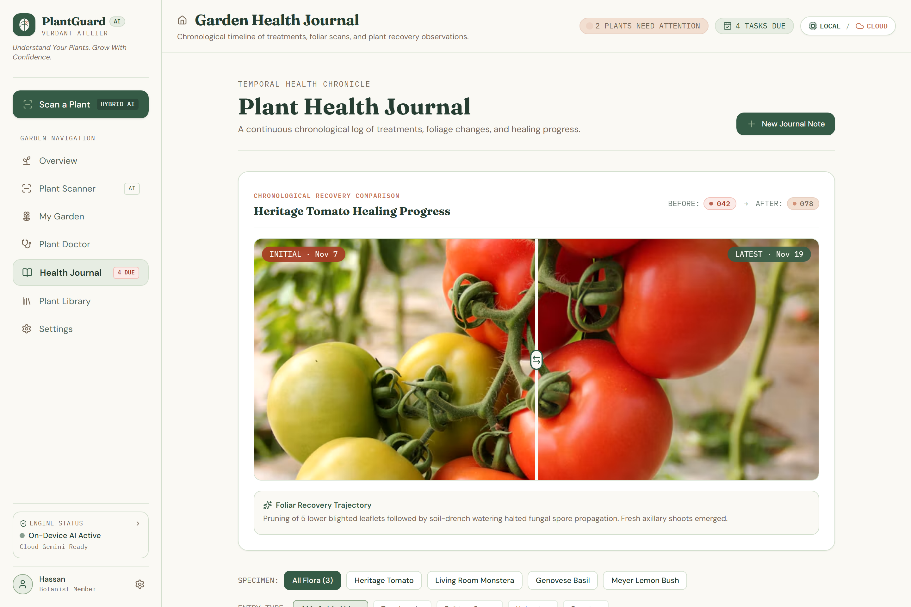
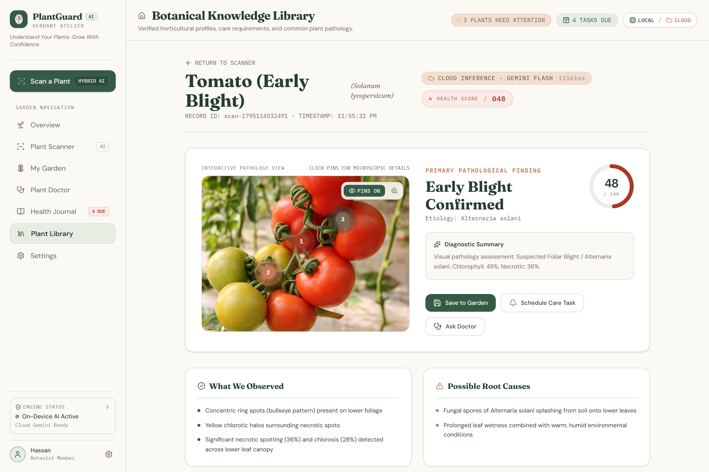
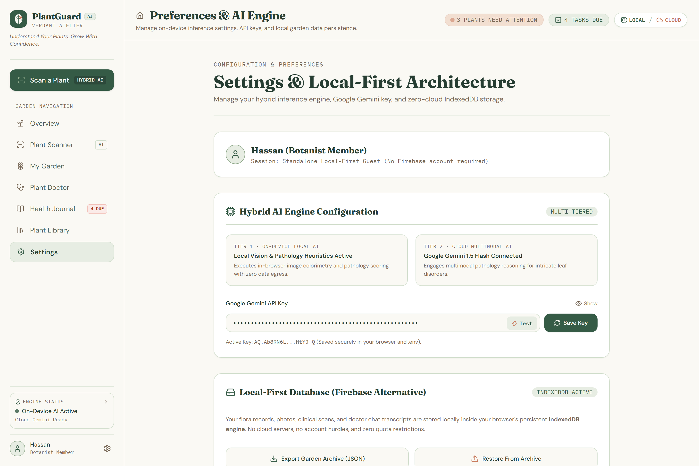

<div align="center">

# 🌿 PlantGuard AI
### *Understand Your Plants. Grow With Confidence.*

[](https://react.dev/)
[](https://www.typescriptlang.org/)
[](https://vitejs.dev/)
[](https://tailwindcss.com/)
[](https://ai.google.dev/)
[](https://developer.mozilla.org/en-US/docs/Web/API/IndexedDB_API)
[](LICENSE)

<br />

**A botanical field journal & hybrid AI plant pathology intelligence platform.**  
Crafted with the *Verdant Paper* editorial design language, client-side spectral computer vision, and multimodal AI diagnostics.

[Key Features](#-key-capabilities) • [Interface Tour](#-visual-tour--interface-gallery) • [AI Pipeline](#-hybrid-ai-pathology-pipeline) • [Design System](#-the-verdant-paper-design-system) • [Quickstart](#-quickstart)

<br />



</div>

---

## 📖 Overview

**PlantGuard AI** redefines plant health tracking by rejecting sterile, generic SaaS dashboards in favor of an **authentic botanical field journal**. Designed for plant collectors, agronomists, horticulturists, and everyday indoor gardeners, it merges heirloom typography and warm textured surfaces with a cutting-edge **3-tier hybrid AI inference pipeline**.

Unlike cloud-dependent apps that require complex backend setups, PlantGuard AI is **Local-First**: it stores full-resolution high-res foliage photographs, treatment histories, and clinical diagnosis logs right inside your browser via asynchronous native **IndexedDB** (`PlantGuardDB`) with zero storage limits and 100% offline functionality.

---

## 📸 Visual Tour & Interface Gallery

<table width="100%">
  <tr>
    <td width="50%">
      <h4 align="center">🌿 Botanical Dashboard & Health Telemetry</h4>
      
      <p align="center"><em>Live health telemetry, care schedule reminders, and quick specimen status.</em></p>
    </td>
    <td width="50%">
      <h4 align="center">🔬 Multimodal Foliar Scanner</h4>
      
      <p align="center"><em>Real-time camera capture, drag-and-drop uploads, and 1-click curated test specimens.</em></p>
    </td>
  </tr>
  <tr>
    <td width="50%">
      <h4 align="center">📋 Pathology Report & Hotspot Inspector</h4>
      
      <p align="center"><em>Interactive foliar symptom coordinate pins, radial score gauge, and treatment protocols.</em></p>
    </td>
    <td width="50%">
      <h4 align="center">🪴 The Herbarium Collection (My Garden)</h4>
      
      <p align="center"><em>Curated digital herbarium specimen cards with high-res leaf archives and medical charts.</em></p>
    </td>
  </tr>
  <tr>
    <td width="50%">
      <h4 align="center">🩺 Conversational AI Plant Doctor</h4>
      
      <p align="center"><em>Diagnostic consultation chat with specimen memory, follow-up photos, and treatment history.</em></p>
    </td>
    <td width="50%">
      <h4 align="center">🎞️ Treatment Journal & Before/After Slider</h4>
      
      <p align="center"><em>Chronological treatment timeline with interactive before/after recovery comparator.</em></p>
    </td>
  </tr>
  <tr>
    <td width="50%">
      <h4 align="center">📚 Botanical Library & Dilution Calculator</h4>
      
      <p align="center"><em>Searchable care encyclopedia with an organic foliar fungicide/neem dilution calculator.</em></p>
    </td>
    <td width="50%">
      <h4 align="center">⚙️ Model Engine & Garden Backup Archive</h4>
      
      <p align="center"><em>Multi-model API key manager, live benchmarks, and 1-click JSON garden export/import.</em></p>
    </td>
  </tr>
</table>

---

## ✨ Key Capabilities

### 🔍 Interactive Foliar Hotspot Inspector
- Direct coordinate mapping of necrotic lesions, chlorosis clusters, and pest damage pins onto the original foliage photo.
- Click any symptom pin to inspect pathology reasoning, tissue damage severity, and affected leaf surface percentage.

### 🧪 Organic Foliar Dilution Calculator
- Built right into the Botanical Encyclopedia.
- Calculate exact measurements (mL or tsp per liter/gallon) for organic remedies:
  - **Neem Oil + Castile Soap Emulsion** (Insecticidal & Antifungal)
  - **Potassium Bicarbonate** (Powdery Mildew Eradicator)
  - **Copper Octanoate Soap** (Bacterial Leaf Spot & Anthracnose)
  - **Bacillus subtilis** (Bio-Fungicide inoculant)

### 🌓 Before & After Recovery Slider
- Drag-and-compare interactive image slider comparing the initial disease scan against post-treatment recovery.
- Track actual leaf healing and new growth over days, weeks, or months.

### 💾 Local-First Zero-Friction Storage
- Stores full-size multi-megabyte camera photos in **IndexedDB** without hitting the 5MB browser localStorage ceiling.
- **1-Click Garden Backup**: Export your complete garden archive to JSON or restore it on any device without mandatory cloud logins.

---

## 🧬 Hybrid AI Pathology Pipeline

PlantGuard AI balances immediate client-side responsiveness with cloud-grade pathology reasoning across a **3-tier inference pipeline**:

```
[ User Foliage Photo / Webcam ]
               │
               ▼
┌─────────────────────────────────────────────────────────────┐
│ STAGE 1: Client-Side Computer Vision (<canvas>)             │
│ • Local spectral pixel analysis                             │
│ • Chlorophyll saturation & Interveinal chlorosis index      │
│ • Necrotic cluster density (Zero Network Egress)            │
└──────────────────────────────┬──────────────────────────────┘
                               │
                               ▼
┌─────────────────────────────────────────────────────────────┐
│ STAGE 2: On-Device Gemini Nano (Chrome window.ai)           │
│ • Edge neural prompt synthesis on user hardware             │
│ • Fallback to local rule-based botanical pathology heuristics│
└──────────────────────────────┬──────────────────────────────┘
                               │
                               ▼
┌─────────────────────────────────────────────────────────────┐
│ STAGE 3: Cloud Multimodal Reasoning (Gemini 1.5 / 2.0 Flash) │
│ • Deep disease taxonomy & secondary pathogen verification   │
│ • Differential diagnosis & curative recovery protocol       │
│ • Transparent badge: [LOCAL · VISION] / [CLOUD · GEMINI]    │
└─────────────────────────────────────────────────────────────┘
```

---

## 🎨 The Verdant Paper Design System

PlantGuard AI adopts the **Verdant Paper** design language — evoking pressed botanical specimens, parchment paper journals, and scientific field notebooks.

### Color Palette

| Swatch | Color Name | Hex Code | Purpose in UI |
| :---: | :--- | :---: | :--- |
|  | **Botanical Ink** | `#263D32` | Primary editorial headings, dark text, high contrast |
|  | **Forest Canopy** | `#355B46` | Primary action buttons, brand signatures, active pills |
|  | **Sage Leaf** | `#8FA88A` | Botanical borders, subtle icons, decorative divider lines |
|  | **Misty Fern** | `#E7EDE3` | Filter surfaces, tags, hover states, muted chips |
|  | **Porcelain Paper**| `#FAF9F4` | Warm textured paper background surface |
|  | **Terracotta Bloom**|`#C8795B` | Accent highlights, alerts, attention tags, primary markers |
|  | **Apricot Dust** | `#F2DFD1` | Subtle warning backgrounds, attention callouts |
|  | **Earth Bark** | `#796A59` | Secondary metadata, timestamps, scientific binomial names |
|  | **Meadow White** | `#FFFFFF` | Elevated reading cards, modals, interactive panels |

### Herbarium Typography

- **Display & Headings**: `Fraunces` — Expressive, warm, editorial serif with variable optical weights.
- **Interface & Body**: `DM Sans` — Clean, legible modern sans-serif optimized for scanning readability.
- **Scientific Metadata**: `IBM Plex Mono` — Monospaced precision for timestamps, telemetry (`HEALTH SCORE: 084`), coordinates, and chemical ratios.

---

## 🛠️ Tech Stack & Architecture

- **Frontend Core**: [React 19](https://react.dev/) + [TypeScript 5.8](https://www.typescriptlang.org/)
- **Bundler & Tooling**: [Vite 6](https://vitejs.dev/) + [Tailwind CSS v4](https://tailwindcss.com/)
- **Icons**: [Lucide React](https://lucide.dev/)
- **AI & Computer Vision**: Google Generative AI SDK (`@google/generative-ai`), Multimodal Gemini 1.5 & 2.0 Flash, Chrome Built-In AI (`window.ai`), HTML5 Canvas Image Processing
- **Storage Layer**: Native Asynchronous **IndexedDB** (`PlantGuardDB`) + Optional Firebase Sync
- **Code Quality**: [oxlint](https://oxc.rs/)

---

## 🚀 Quickstart

### Prerequisites
- [Node.js](https://nodejs.org/) (v18.0.0 or later)
- `npm` or `pnpm`

### Installation

```bash
# 1. Clone the repository
git clone https://github.com/IHassanshaikh/PlantGuard-AI-Understand-Your-Plants.-Grow-With-Confidence..git

# 2. Navigate to the project directory
cd PlantGuard-AI-Understand-Your-Plants.-Grow-With-Confidence.

# 3. Install dependencies
npm install

# 4. Configure your environment
cp .env.example .env
```

### Configure API Key
Open `.env` and add your Google Gemini API key:
```env
VITE_GEMINI_API_KEY=your_gemini_api_key_here
```
*(Alternatively, leave it blank and configure your key directly in the in-app **Settings** modal with live connection validation!)*

### Start Development Server
```bash
npm run dev
```

Open [http://localhost:5173](http://localhost:5173) in your browser.

---

## 📦 Build & Scripts

| Command | Action |
| :--- | :--- |
| `npm run dev` | Starts Vite local development server with hot-module reload |
| `npm run build` | Compiles TypeScript and builds production distribution in `/dist` |
| `npm run preview`| Previews production build locally |
| `npm run lint` | Runs ultra-fast `oxlint` static code analysis |

---

## 📄 License

This project is licensed under the **MIT License** — see the [LICENSE](LICENSE) file for details.

<div align="center">
  <sub>Built with 🌿 care by <a href="https://github.com/IHassanshaikh">Muhammad Hassan</a>. Understand Your Plants. Grow With Confidence.</sub>
</div>
